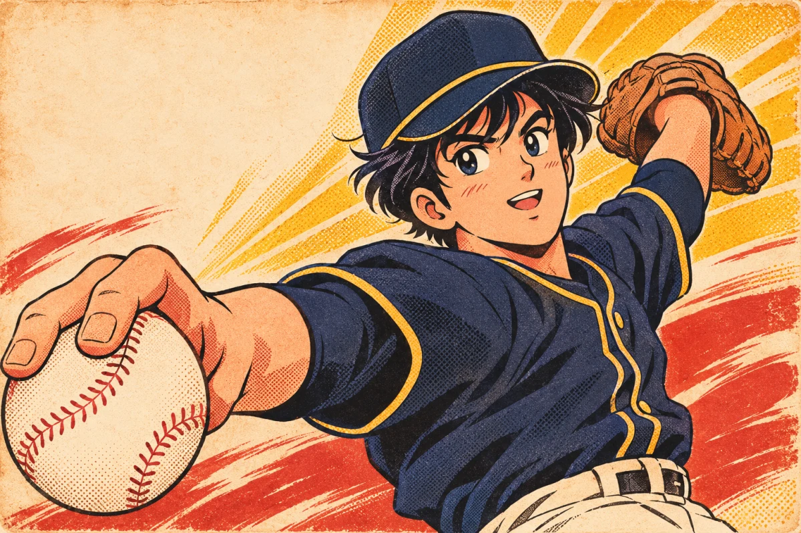
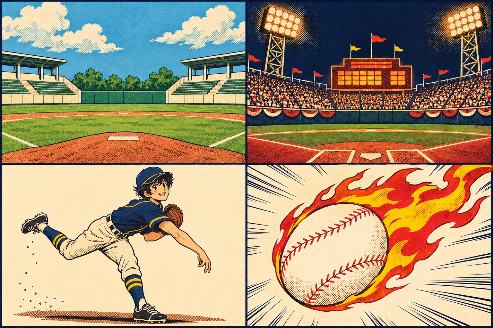

# 무한 피칭 리뉴얼 시안

**방과 후 야구부**를 게임 전체의 얼굴로 잡는다. 예전 야구 만화의 검은 외곽선, 망점 인쇄, 종이색, 큰 공의 원근감을 활용한다. 주인공은 15–16세 정도의 야구부 선수로, 작은 체격과 둥근 얼굴선, 밝고 집중한 표정, 여유 있는 유니폼을 쓴다. 특정 성별로 강하게 읽히는 얼굴이나 체격을 피하고, 투구의 힘은 손과 공의 원근, 대각선 구도와 스피드라인으로 표현한다. 참고 사진의 캐릭터, 팀명, 모자 로고는 게임 고유의 디자인으로 새로 만든다.

[메뉴 프로토타입](menu.html) · [메뉴 미리보기](assets/menu-preview.webp) · [홈 키 일러스트](assets/home-hero.webp) · [인게임 아트 보드](assets/field-studies.webp)

## 일러스트 방향

| 시안 | 그림과 색 | 배치 |
| --- | --- | --- |
| **A. 방과 후 야구부 · 메인** | 아이보리 종이, 잉크 남색 유니폼, 머스터드 햇빛, 주홍 스피드라인. 웃으며 공을 들어 보이는 투수와 가까이 보이는 공을 한 컷에 담는다. | 홈, 시작 화면, 앱 대표 이미지 |
| **B. 동네 연습장 · 솔로/친구** | 낮은 관중석, 흙빛 마운드, 잔디색. 좌우 가장자리에 배경 요소를 두고, 번호판 뒤는 낮은 대비의 큰 색면을 사용한다. | 나홀로 특훈, 친구와 특훈, 튜토리얼 |
| **C. 야간 교류전 · 배틀** | 잉크 남색 하늘, 따뜻한 조명과 주홍 전광판. 관중은 작게 처리하고, 조명은 코트 가장자리에 둔다. | 세계 8인 배틀 로비, 경기 시작, 배틀 결과 |

A/B/C는 서로 다른 브랜드 후보가 아니라 같은 캐릭터와 인쇄 질감으로 묶이는 세 가지 화면 연출이다. 홈은 A로 고정하고, 게임 모드에 들어가면 B/C로 경기의 성격을 바꾼다.

보드의 왼쪽 위부터 시계 방향으로 낮 훈련장, 야간 경기장, 파이어볼, 투구 자세를 보여준다. 프로토타입의 홈에는 키 일러스트를, 솔로 훈련 화면과 8인 배틀 로비에는 각각 낮과 밤 구장을 적용했다. 포즈와 마구는 별도 제작을 위한 시안이다.

| 제작 묶음 | 다음 시안에서 필요한 리소스와 기준 |
| --- | --- |
| 타이틀·런처 | 회사 로고 스플래시와 게임 표지는 파일을 분리한다. 정식 일문 타이틀 `超特訓！無限ピッチング`과 현지화 이름은 별도 레이어로 둔다. 앱 아이콘은 공+모자 실루엣을 정사각형과 마스커블로 제작한다. |
| 홈·로비 아트 | 홈 일러스트 3:2, 로비 야간 배경 9:16. 얼굴과 공은 별도로 크롭을 검토한다. 타이틀과 안내 문구는 이미지가 아닌 UI 텍스트로 렌더링한다. |
| 투수·카트 | 동일 인물의 준비·릴리스 포즈와 카트. 투수 스프라이트는 투명 PNG, 같은 프레임 크기와 발 기준점으로 제공한다. 동작 교체 시 좌우 중심과 바닥 위치가 튀지 않아야 한다. |
| 게임 필드·블록 | 1080×1920 논리 화면 기준으로 낮과 밤 배경을 분리한다. 10열 블록의 숫자는 Canvas 텍스트로 유지하고, 기본 블록과 목표 블록의 윤곽·명도 차이를 확보한다. |
| 마구 | 파이어는 불꽃과 세로 궤적, 미러는 쌍을 이룬 반전 띠, 스트라이프는 교차 띠, 플래시는 별 모양과 짧은 펄스로 구분한다. 컬러와 실루엣을 함께 사용하고 숫자와 경기판을 오래 덮지 않는다. |
| UI 소재 | 기록 카드, 대기 슬롯, 1·2·3위 표기, 장착/잠김/연승 상태를 같은 테두리와 스탬프 시스템으로 맞춘다. 배틀 HUD 8칸은 입장 순서를 유지하고 내 슬롯에 ‘나’ 라벨과 외곽선을 붙인다. |

## 메뉴와 상태

아래 작동 기준은 현재 게임 코드에서 확인했다. [홈과 기존 메뉴](../../index.html#L3872) · [웹/앱 플레이 조건](../../index.html#L6114) · [리그와 대기 시간](../../index.html#L9340) · [배틀 해금](../../index.html#L11185) · [친구방 흐름](../../index.html#L11259)

| 상태 또는 화면 | 리뉴얼 정의 |
| --- | --- |
| 첫 실행 | 시작 → 언어 선택 → 선수 이름 등록 → 홈. 이름 제한과 변경 불가 안내는 입력 아래에 표시한다. 기존 선수의 Google·Apple 복원은 같은 화면 아래에 둔다. |
| 홈 · 솔로 최고 31점 미만 | **나홀로 특훈**이 주 버튼이다. 세계 8인 배틀에 ‘솔로 최고 24 / 31점’처럼 진행을 표시한다. 잠긴 항목을 열면 해금 안내와 솔로로 가는 버튼을 보여준다. 친구와 특훈은 바로 접근할 수 있다. |
| 홈 · 솔로 최고 31점 이상 | **세계 8인 배틀**이 주 버튼이 된다. 나홀로 특훈과 친구와 특훈은 같은 줄에 둔다. 홈 기록 카드는 선수명·솔로 최고·배틀 PT만 읽히게 하고, 리그와 누적 우승은 배틀 로비에서 보여준다. |
| 세계 8인 배틀 | 로비에서 리그, 승점, 누적 우승을 본다. 일반은 1,200 PT 이하, 마스터는 1,200 PT 초과다. ‘빠른 매칭’ 후 카운트다운·실제 선수 수·8칸 슬롯·취소를 한 화면에 둔다. 최대 20초 대기와 빈자리 봇 충원 규칙을 따르고, 로비 진입만으로 매칭을 시작하지 않는다. |
| 친구와 특훈 | **방 만들기**와 **4자리 코드로 참가**를 첫 화면에 놓는다. 현재 코드의 진입 즉시 생성 방식을 명시적 선택으로 바꾸는 제안이다. 방장은 코드와 참가 인원을 보고 2명부터 시작한다. 참가자는 방장 대기 상태를 본다. 없는 방·가득 찬 방·이미 시작한 방 오류는 코드 입력 아래에 표시한다. |
| 기록 | 하단에서 랭킹에 직접 접근한다. 기존 4개 조회 조합을 ‘8인 배틀 / 나홀로 특훈’과 ‘세계 / 국가’ 두 축으로 바꾼다. 배틀은 PT, 솔로는 점수로 표시한다. 로딩·빈 목록·재시도를 같은 자리에서 처리한다. |
| 컬렉션 | 하단에서 접근한다. 획득 조건과 ‘잠김 / 장착 / 장착 중’ 상태를 표시하고 기존 숨겨진 컬렉션은 조건을 충족한 뒤에 표시한다. |
| 설정과 이용권 | 우상단 설정에서 언어 5종, BGM·SFX, 계정 연동을 찾을 수 있다. 웹은 기본 무제한 플레이이므로 홈에 일일 횟수를 내세우지 않는다. 앱에서 한도가 적용되는 경우 플레이 버튼을 눌렀을 때 남은 횟수와 필요한 광고, 광고 제거, 복원 옵션을 표시한다. 실제 스토어 가격을 사용한다. |
| 결과 | 솔로는 이번 점수·최고 기록·다시 도전을 먼저 표시한다. 8인 배틀은 순위·PT 변화·참가자 기록 순으로 보여준다. 경기 진행 중 안내에서는 예상 순위에 ‘잠정’을 붙이고, 최종 기록과 구분한다. |

## UI 규격

- 세로 390px을 기본으로 잡고 320px까지 줄바꿈을 허용한다. 홈은 **타이틀 일러스트 → 선수 기록 → 모드 버튼 → 홈·랭킹·컬렉션** 순서다. 게임 중에는 하단 메뉴를 숨기고 HUD와 뒤로 가기만 남긴다.
- 종이색 `#F9EDCF`, 잉크 `#192738`, 주 버튼 주홍 `#A6312C`, 배지 머스터드 `#EDBC57`, 진행 표시 잔디 `#286659`. 페이지 본문과 숫자가 있는 판에는 망점을 깔지 않는다.
- 말투는 짧고 친근하게 유지한다. ‘솔로 최고 기록을 31점까지 올려요’, ‘선수를 찾는 중’, ‘친구를 기다리는 중’처럼 다음 행동이 보이는 표현을 사용한다. 타이틀과 버튼은 다국어 문구에 맞춰 줄바꿈할 수 있어야 한다.
- 터치 영역은 최소 44px을 확보하고 포커스를 표시한다. 잠김, 장착, 내 순위, 다음 번호는 글자나 윤곽을 함께 쓰며, 강한 화면 점멸은 줄인다. 상하 안전 영역을 적용한다.
- 배포용 홈 일러스트는 약 350 KiB 이내를 목표로 한다. 구장·마구는 필요한 화면에서 불러온다. 앱 대표 아이콘과 스프라이트는 실제 크기 축소와 반복 재생을 검토한다.

프로토타입은 ‘첫 실행’, ‘해금 전’, ‘일반’, ‘마스터’를 바꿔 볼 수 있다. 선수 이름과 설정은 탭이 열린 동안만 유지된다. 화면 문구는 한국어이며 매칭, 랭킹과 초대방은 예시 데이터로 동작한다. 게임 플레이, 실제 로그인·결제·데이터 저장은 기존 게임의 기능이다.

## 이미지 제작 기록

내장 ImageGen을 사용했다. 아래는 시안에 적용한 프롬프트다.

**홈 키 일러스트**

Use case: illustration-story. One landscape 3:2 full-bleed key illustration for a mobile Japanese/Korean retro baseball training game. The supplied image is a STYLE REFERENCE for analog sports comic printing only. Create one ORIGINAL youthful East Asian high-school baseball pitcher, about 15–16 years old, approachable and lightly androgynous character design. Rounded cheeks and gentle jawline, expressive bright eyes, loose short dark hair under the cap, light athletic build, relaxed shoulders, a small open confident smile. The mood is spirited after-school club sports, friendly and optimistic, accessible to a mixed audience. Wear an ink navy vintage cap and roomy baseball jersey with soft mustard piping, ivory pants. No letters or numbers. Show an anatomically natural overhand wind-up just before the throw, with a large stitched baseball in the hand in the near foreground on the left, and the face in the center-right. Energetic ivory and soft vermilion speed strokes and sunlit mustard fan burst, plus a warm paper edge. Keep the top left less busy for a game title that will be added separately. Clear two-color shadows, slightly irregular ink contours, visible controlled Ben-Day dots, old screenprinted Showa sports manga spirit with warm peach skin and positive bright color, clean and clear at 390px wide. No other characters, no typography, no logos, no watermarks, no flames around the person, no scowl, no heavy squared jaw, no muscular adult physique, no photorealism, no border. Artwork only.

**인게임 아트 보드 기반 이미지**

Use case: stylized-concept. Design ONE professional landscape 3:2 game art-direction exploration sheet, a 2 by 2 grid of exactly FOUR equal framed picture panels divided with crisp thin dark-navy comic gutters, ALL artwork with NO TEXT or inscriptions of any kind. Retro East Asian baseball arcade game, showa sport manga printing, original designs. Input image 1 is a style reference for thick ink contour, warm limited spot colors and fine Ben-Day shadow dots, use no original cast, logos or lettering. Each panel fills its entire quarter and reads separately. Upper left: wide daytime baseball training field at ground level from behind the mound, clay, grass, simple symmetrical cream and green bleachers, very quiet blocks of color, open unobstructed middle for a number-board overlay. Upper right: night stadium floodlights, dark navy sky, saturated red-orange scoreboard glow, crowds simplified to halftone grain, high-stakes competitive atmosphere. Lower left: original navy-cap, navy-shirt and cream-pants adult pitcher, full body caught in a powerful overhand follow-through on a neutral warm ivory background, character silhouette completely visible, dynamic game sprite reference. Lower right: big stitched baseball ripping through a single vermilion-and-mustard flame, sharp ink contour, recognizable white core, ivory backdrop with speed lines, comic special move cut-in. Keep all panels stylistically cohesive and clearly separated. Hand-inked black-navy linework and controlled dots, strong large shapes, readable at mobile scale. No titles, no digits, no signage, no UI overlays, no watermarks, no montage bleeding across panel lines.

**인게임 아트 보드에서 주인공 포즈 수정**

Use case: precise-object-edit. Image 1 is a four-panel concept artwork sheet to edit. Image 2 is the finalized youthful pitcher identity reference. Change ONLY the bottom-left quarter of Image 1, preserving daylight field upper-left, night stadium upper-right, fireball lower-right and navy gutters exactly. In lower-left, draw a full-body sprite pose study on the same warm neutral ivory. Replace the adult with the SAME youthful high-school club pitcher as Image 2, soft cheeks, gentle jawline, youthful slender frame, cap and navy jersey with mustard piping, light club uniform, warm and approachable styling. Pose is a clear athletic right-handed overhand follow-through, see both feet plus the glove, well inside its panel. Keep the other three quadrants and gutters in the same proportions and unchanged. Landscape 3:2. Retain uniform print linework, halftone dots and paper. No numbers, labels, signature or text.
