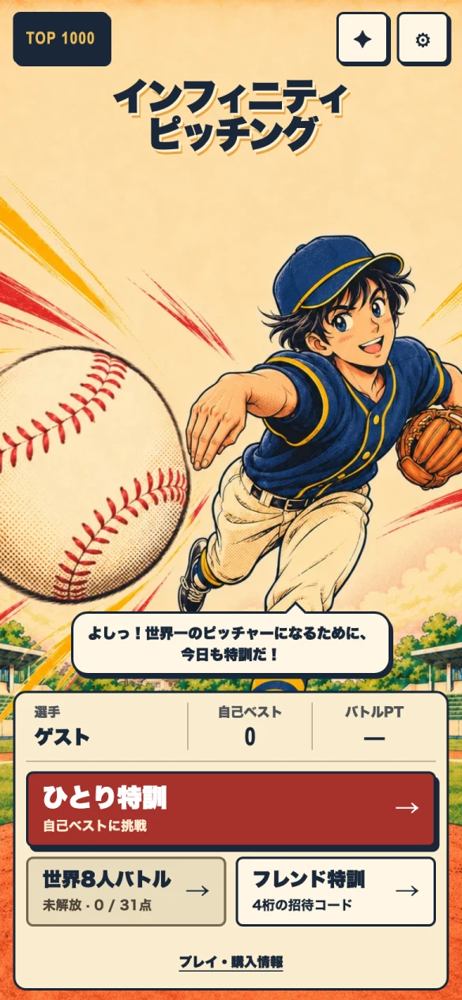

# 인피니티 피칭 리뉴얼 시안

**방과 후 야구부**를 게임 전체의 얼굴로 잡는다. 예전 야구 만화의 검은 외곽선, 망점 인쇄, 종이색, 큰 공의 원근감을 활용한다. 주인공은 15–16세 정도의 야구부 선수로, 작은 체격과 둥근 얼굴선, 밝고 집중한 표정, 여유 있는 유니폼을 쓴다. 특정 성별로 강하게 읽히는 얼굴이나 체격을 피하고, 투구의 힘은 손과 공의 원근, 대각선 구도와 스피드라인으로 표현한다. 참고 사진의 캐릭터, 팀명, 모자 로고는 게임 고유의 디자인으로 새로 만든다.

[타이틀부터 체험](menu.html) · [오프닝 미리보기](assets/opening-preview.webp) · [투구 GIF](assets/title-pitch.gif) · [메뉴 미리보기](assets/menu-preview.webp) · [인게임 아트 보드](assets/field-studies.webp)

## 타이틀에서 메인 메뉴로

1. 9:16 오프닝에 마운드에 선 투수의 전신과 일본어 타이틀 **インフィニティピッチング**을 보여준다.
2. ‘スタート’를 누르면 오른손 투수가 오른발을 축으로 왼무릎을 들고, 왼발을 디딘 뒤 오른손으로 던진다. 첫 자세와 마지막 원근 컷을 연결한 [Magnific 연속 영상](https://www.magnific.com/app/creation/eIyBZmJdqL)에서 73개 프레임을 그대로 추출했다. GIF는 3.04초이며 한 번 재생한다.
3. GIF의 마지막 프레임을 고화질 정지 화면으로 이어 붙인다. 화면 앞까지 다가온 공과 투수의 자세가 고정된 상태에서 좌상단에 **TOP 1000**, 우상단에 **컬렉션·설정**, 가운데에 기존 말풍선을 띄운다. 하단에는 선수 기록, 세 게임 모드와 플레이·구매 정보를 표시한다.

> よしっ！世界一のピッチャーになるために、 
> 今日も特訓だ！

‘スキップ’을 누르거나 기기에 동작 줄이기가 설정되어 있으면 고정 컷과 메뉴를 바로 보여준다. 첫 접속에는 게스트 상태로 홈을 먼저 둘러볼 수 있고, 처음 게임 모드를 선택할 때 선수 이름 등록을 안내한다.

## 일러스트 방향

| 시안 | 그림과 색 | 배치 |
| --- | --- | --- |
| **A. 방과 후 야구부 · 메인** | 아이보리 종이, 잉크 남색 유니폼, 머스터드 햇빛, 주홍 스피드라인. 오프닝은 마운드 위 투수의 전신, 홈은 공이 카메라를 향해 날아드는 투구 직후의 원근 컷을 담는다. | 오프닝, 홈, 앱 대표 이미지 |
| **B. 동네 연습장 · 솔로/친구** | 낮은 관중석, 흙빛 마운드, 잔디색. 좌우 가장자리에 배경 요소를 두고, 번호판 뒤는 낮은 대비의 큰 색면을 사용한다. | 나홀로 특훈, 친구와 특훈, 튜토리얼 |
| **C. 야간 교류전 · 배틀** | 잉크 남색 하늘, 따뜻한 조명과 주홍 전광판. 관중은 작게 처리하고, 조명은 코트 가장자리에 둔다. | 세계 8인 배틀 로비, 경기 시작, 배틀 결과 |

A/B/C는 서로 다른 브랜드 후보가 아니라 같은 캐릭터와 인쇄 질감으로 묶이는 세 가지 화면 연출이다. 홈은 A로 고정하고, 게임 모드에 들어가면 B/C로 경기의 성격을 바꾼다.

보드의 왼쪽 위부터 시계 방향으로 낮 훈련장, 야간 경기장, 파이어볼, 투구 자세를 보여준다. 프로토타입의 홈에는 키 일러스트를, 솔로 훈련 화면과 8인 배틀 로비에는 각각 낮과 밤 구장을 적용했다. 포즈와 마구는 별도 제작을 위한 시안이다.

| 제작 묶음 | 다음 시안에서 필요한 리소스와 기준 |
| --- | --- |
| 타이틀·런처 | 회사 로고 스플래시와 오프닝을 분리한다. [오프닝 원화](assets/opening-fullshot.webp)는 9:16 세로 전신 컷으로, 모자부터 양쪽 스파이크까지 들어온다. 일본어 타이틀 `インフィニティピッチング`은 별도 텍스트 레이어에 둔다. 앱 아이콘은 공과 모자의 실루엣으로 제작한다. |
| 홈·로비 아트 | [홈 고정 컷](assets/title-pitch-finish.webp)은 오프닝과 같은 9:16이다. 얼굴과 공이 말풍선에 가리지 않는지 확인한다. 야간 구장 로비 시안은 보드에서 확인할 수 있다. |
| 투수·카트 | 동일 인물의 준비·릴리스 포즈와 카트. 투수 스프라이트는 투명 PNG, 같은 프레임 크기와 발 기준점으로 제공한다. 동작 교체 시 좌우 중심과 바닥 위치가 튀지 않아야 한다. |
| 게임 필드·블록 | 1080×1920 논리 화면 기준으로 낮과 밤 배경을 분리한다. 10열 블록의 숫자는 Canvas 텍스트로 유지하고, 기본 블록과 목표 블록의 윤곽·명도 차이를 확보한다. |
| 마구 | 파이어는 불꽃과 세로 궤적, 미러는 쌍을 이룬 반전 띠, 스트라이프는 교차 띠, 플래시는 별 모양과 짧은 펄스로 구분한다. 컬러와 실루엣을 함께 사용하고 숫자와 경기판을 오래 덮지 않는다. |
| UI 소재 | 기록 카드, 대기 슬롯, 1·2·3위 표기, 장착/잠김/연승 상태를 같은 테두리와 스탬프 시스템으로 맞춘다. 배틀 HUD 8칸은 입장 순서를 유지하고 내 슬롯에 ‘나’ 라벨과 외곽선을 붙인다. |

## 메뉴와 상태

아래 작동 기준은 현재 게임 코드에서 확인했다. [홈과 기존 메뉴](../../index.html#L3872) · [웹/앱 플레이 조건](../../index.html#L6114) · [리그와 대기 시간](../../index.html#L9340) · [배틀 해금](../../index.html#L11185) · [친구방 흐름](../../index.html#L11259)

| 상태 또는 화면 | 리뉴얼 정의 |
| --- | --- |
| 첫 실행 | 세로 전신 타이틀 → 투구 GIF → 메인 메뉴. 첫 모드 선택 시 선수 이름 등록 → 선택했던 모드로 이동한다. 이름 제한과 변경 불가 안내는 입력 아래에 두고, Google·Apple 복원은 같은 화면에서 접근한다. |
| 홈 · 솔로 최고 31점 미만 | **나홀로 특훈**이 주 버튼이다. 세계 8인 배틀에 ‘솔로 최고 24 / 31점’처럼 진행을 표시한다. 잠긴 항목을 열면 해금 안내와 솔로로 가는 버튼을 보여준다. 친구와 특훈은 바로 접근할 수 있다. |
| 홈 · 솔로 최고 31점 이상 | **세계 8인 배틀**이 주 버튼이 된다. 나홀로 특훈과 친구와 특훈은 같은 줄에 둔다. 홈 기록 카드는 선수명·솔로 최고·배틀 PT만 읽히게 하고, 리그와 누적 우승은 배틀 로비에서 보여준다. |
| 세계 8인 배틀 | 로비에서 리그, 승점, 누적 우승을 본다. 일반은 1,200 PT 이하, 마스터는 1,200 PT 초과다. ‘빠른 매칭’ 후 카운트다운·실제 선수 수·8칸 슬롯·취소를 한 화면에 둔다. 최대 20초 대기와 빈자리 봇 충원 규칙을 따르고, 로비 진입만으로 매칭을 시작하지 않는다. |
| 친구와 특훈 | **방 만들기**와 **4자리 코드로 참가**를 첫 화면에 놓는다. 현재 코드의 진입 즉시 생성 방식을 명시적 선택으로 바꾸는 제안이다. 방장은 코드와 참가 인원을 보고 2명부터 시작한다. 참가자는 방장 대기 상태를 본다. 없는 방·가득 찬 방·이미 시작한 방 오류는 코드 입력 아래에 표시한다. |
| 기록 | 좌상단 TOP 1000에서 접근한다. 기존 4개 조회 조합을 ‘8인 배틀 / 나홀로 특훈’과 ‘세계 / 국가’ 두 축으로 바꾼다. 배틀은 PT, 솔로는 점수로 표시한다. 로딩·빈 목록·재시도를 같은 자리에서 처리한다. |
| 컬렉션 | 우상단에서 접근한다. 획득 조건과 ‘잠김 / 장착 / 장착 중’ 상태를 표시하고 기존 숨겨진 컬렉션은 조건을 충족한 뒤에 표시한다. |
| 설정과 이용권 | 우상단 설정에서 언어 5종, BGM·SFX, 계정 연동을 찾을 수 있다. 웹은 기본 무제한 플레이이므로 홈에 일일 횟수를 내세우지 않는다. 앱에서 한도가 적용되는 경우 플레이 버튼을 눌렀을 때 남은 횟수와 필요한 광고, 광고 제거, 복원 옵션을 표시한다. 실제 스토어 가격을 사용한다. |
| 결과 | 솔로는 이번 점수·최고 기록·다시 도전을 먼저 표시한다. 8인 배틀은 순위·PT 변화·참가자 기록 순으로 보여준다. 경기 진행 중 안내에서는 예상 순위에 ‘잠정’을 붙이고, 최종 기록과 구분한다. |

## UI 규격

- 세로 390px을 기본으로 잡고 320px까지 줄바꿈을 허용한다. 홈은 화면 전체에 투구 마지막 컷을 깔고 상단에는 빠른 메뉴와 타이틀, 가운데에는 말풍선, 하단에는 기록과 모드 버튼을 올린다.
- 종이색 `#F9EDCF`, 잉크 `#192738`, 주 버튼 주홍 `#A6312C`, 배지 머스터드 `#EDBC57`, 진행 표시 잔디 `#286659`. 페이지 본문과 숫자가 있는 판에는 망점을 깔지 않는다.
- 말투는 짧고 친근하게 유지한다. ‘솔로 최고 기록을 31점까지 올려요’, ‘선수를 찾는 중’, ‘친구를 기다리는 중’처럼 다음 행동이 보이는 표현을 사용한다. 타이틀과 버튼은 다국어 문구에 맞춰 줄바꿈할 수 있어야 한다.
- 터치 영역은 최소 44px을 확보하고 포커스를 표시한다. 잠김, 장착, 내 순위, 다음 번호는 글자나 윤곽을 함께 쓰며, 강한 화면 점멸은 줄인다. 상하 안전 영역을 적용한다.
- 배포용 홈 일러스트는 약 350 KiB 이내를 목표로 한다. 구장·마구는 필요한 화면에서 불러온다. 앱 대표 아이콘과 스프라이트는 실제 크기 축소와 반복 재생을 검토한다.

프로토타입은 ‘타이틀 다시 보기’, ‘해금 전’, ‘일반’, ‘마스터’를 바꿔 볼 수 있다. 게임 화면 문구는 일본어이며 매칭, 랭킹과 초대방은 예시 데이터로 동작한다. 선수 이름과 설정은 탭이 열린 동안 유지된다.

## 이미지 제작 기록

내장 ImageGen을 사용했다. 아래는 시안에 적용한 프롬프트다.

**오른손 투구의 왼무릎 들기**

Use case: illustration-story. Four close sequential KEYFRAMES in one exact 2 by 2 grid; full-bleed 9:16 overall portrait, each quadrant an equally sized uninterrupted vertical 9:16 work, straight midpoint cut with no gutters or dividing lines, no writing or numbering. The input is the precise approved baseball pitcher identity, front three-quarter staging camera, outfit, palette and stadium background. Manually animate a RIGHT-HANDED pitch preparation. Same young, softly androgynous 15–16-year-old player and face as reference, navy cap/jersey and mustard piping, ivory pants and blue stirrups. Fixed camera tripod and field horizon, pitcher same size and head vertical position, full body centered with roomy edges and clean silhouette, two arms and two legs only. CONSISTENT ANATOMY IN ALL FOUR: the left hand of the pitcher (on the VIEWER'S RIGHT when facing us) wears the brown glove. Right hand (VIEWER'S LEFT when front facing) owns white baseball. The RIGHT leg is the support leg, its right cleat stays at the SAME spot slightly LEFT OF FRAME CENTER in every quadrant, aligned under the right hip. Only the player's LEFT foot on the VIEWER'S RIGHT ever lifts and bends toward their left hip during this sequence. Use tiny sequential pose differences and maintain camera alignment like production animation cels: TOP LEFT—arms gather together at chest, both feet just on ground, left heel starting to peel off; TOP RIGHT—left foot now slightly off the ground and left knee flexed at shin height, right leg vertical and firmly planted; BOTTOM LEFT—left knee higher just BELOW waist, lift unmistakably on right side of image, glove and hands together; BOTTOM RIGHT—left knee lifted to waist, left boot hangs off ground entirely, right leg supports at unchanged spot, with slight shoulder coil. Keep all backgrounds nearly identical to the reference, no speed strokes or added camera movement. Quiet cream sky, bleachers, green grass and terracotta. Vintage inked Showa sports comic contours, same clean screen printing, youthful expression. No text, lettering, marks, watermarks, no borders, no extra hands or feet.

**왼발 착지와 오른손 릴리스**

Use case: illustration-story. A four-keyframe animation sheet arranged as an exact 2 by 2 grid without gutters, border or lines; all four panels are seamless upright 9:16 portrait artworks, whole image 9:16 portrait, straight center cut boundaries. Use input 1 as exact youthful high-school player and consistent camera/field reference plus input 2 as rough old staging only. Draw a subtle progressive RIGHT-HANDED pitch from the top of the leg kick to the exact moment after the ball leaves the hand. Same young, softly androgynous face, blue cap and dark navy jersey with mustard piping, cream pants and blue socks, in same daylight field and terracotta mound. Locked camera and horizon, same player centered, unobstructed head to cleats, no changing viewpoint. Front-facing three-quarter angle. Their LEFT hand, at viewer right, wears the brown glove for all four poses. Their RIGHT hand, which originates on viewer left, throws. Right leg, on viewer left, has supported the weight; the left leg (toward viewer right) has lifted and now moves ahead to plant. TOP LEFT: lifted left knee begins to descend toward viewer right, right foot stays planted on viewer left, chest-level hands start to separate. TOP RIGHT: left foot strides and almost touches ground to viewer right; right throwing hand holds a small white baseball behind and above shoulder on viewer left, glove leads on viewer right. BOTTOM LEFT: left foot FIRMLY planted to viewer right, right rear foot on viewer left begins to roll forward; throwing elbow and right hand move overhand up and forward toward the camera, shoulder and hips rotate naturally; ball is still held by right fingertips. BOTTOM RIGHT: right arm comes forward, ball is released and clearly separated from right fingertips, left foot still planted to viewer right, right heel lifts behind body at viewer left. Right throwing hand after release has a relaxed accurate shape, one thumb and four fingers. Minimal differences in scale or framing between frames. Screen-printed Showa sports manga, paper grain and Ben-Day dots just like first input, warm bright friendly tone. The design is NOT a diagram; do not insert text, symbols, labels, typography, borders, arrows, signs, watermarks, or additional limbs.

**고정 컷의 오른손과 손목 수정**

Use case: precise-object-edit. The input is the complete portrait target frame. Preserve the same layout, centered cheerful young baseball pitcher, face, uniform, cap, colors, the large already-flying ball in the left foreground, speedlines and baseball field. Make one targeted correction to the non-gloved THROWING RIGHT HAND AND WRIST, which appears on the left side of the image just behind the airborne ball. Redraw this one hand from scratch as a clearly human right hand, with an ordinary anatomically accurate right wrist continuous with the existing forearm. Natural overhand pitching follow-through just after release: the forearm has pronated, the wrist and fingertips point diagonally downward, and ALL FOUR fingers relax close together in a smooth compact curve, plus one much shorter opposable thumb tucked naturally beside the index. Five digits total, based on a real athletic reference, clean silhouettes, correct finger lengths, consecutive index, middle, ring, little finger knuckles, natural joints, no claw or unnatural fanning, no extra or fused digits, no look of holding the ball. Prefer a slightly turned, mostly back-of-hand view with carefully drawn four natural dorsal knuckles and one modest thumb. Keep it clear at phone size and proportionate to the player, the baseball is the main foreshortened object. Keep the player's LEFT SKINLESS/covered hand inside the existing glove on the right side of the image. Preserve every other element. Same seamless 9:16 portrait. No text, labels, signs, or watermarks.

**투구 GIF 중간 자세**

Use case: illustration-story. Create one production-friendly FOUR-KEYFRAME storyboard grid for a quick hand-inked baseball pitching animation. Content is artwork ONLY, no writing, no titles, no badges, no labels, no numbering, no interface. Overall 9:16 portrait aspect; exact edge-to-edge 2 by 2 grid with an invisible straight cut at x=50% and y=50%. Each equal quadrant is a COMPLETE independent upright portrait illustration with no margins, no drawn gutters and no object crossing a quadrant edge. The input image is the exact character and stadium reference. All quadrants depict the SAME original softly androgynous, slender, young high-school pitcher with short loose dark hair, round cheeks, bright eyes, ink navy cap and old uniform with mustard piping, ivory pants, navy stirrups, dark cleats. All use same field, day lighting, pale cream sky, same centered camera, horizon at about 64% down, terracotta mound low in frame and pale gold/vermillion speed accents. Anchor pitcher at center; entire player in frame, from head to cleats. Show four DISTINCT sequential accurate right-handed overhand pitching POSES, each drawn deliberately as an animation key: upper left = brings glove and throwing hand together at chest, left knee rising just above waist while balanced on right foot, body turned slightly; upper right = long stride, left foot about to plant in front, glove hand points forward and right throwing arm holds the visible ball high and behind player, torso coiled; lower left = extreme energy at release, left foot planted, right arm whipping overhand high and forward, visible bright baseball has just separated from fingers, torso leans forward, right rear leg starts rising; lower right = follow-through, torso lands forward and right arm crosses downward toward opposite hip, right leg kicks high behind, ball rushes toward camera in left foreground about one quarter of frame width. Same scale and horizon across panels. Readable, simple transition silhouettes. Old Showa sports manga flat screen-print inks, Ben-Day dots, warm paper, strong contours, optimistic club-sports feeling. No photo-style lighting, no excessive muscle, no angry expressions, no diagram, no different costumes or people, no weapons. Hard cuts exactly at quadrant boundaries only.

**투구 원근 고정 컷**

Use case: illustration-story. Produce one original full-bleed 9:16 portrait artwork, inked Showa sports manga. The first reference is the currently approved young high-school pitcher, outfit colors and neighborhood field. The second reference is the kind of dynamic perspective and graphic printing for the finished pitch. Keep the same identity from reference 1, approximately 15–16, softly androgynous, loose dark hair and rounded youthful cheeks, bright optimistic expression, ink navy cap and jersey mustard piping, cream pants. Capture the exact spectacular instant just AFTER the right hand has let go of the ball. Dramatic wide-angle from the batter's point of view: a dramatically large, round, stitched baseball flies directly at camera in the LEFT foreground, around x 30%, y 46%, its diameter about 38% of the entire image width, with a readable white leather surface and red stitches. The pitcher leans forward from the center-right behind it, their smile and facial identity clearly seen well separated to the upper right of the ball, around x 63%, y 35%; glove in the other hand, coordinated real pitching anatomy, no fingers gripping the airborne ball. Place the key action between y=25% and y=60%. Leave the upper quarter mostly open pale warm cream paper sky. Keep the lower third quiet light clay and green baseball-field color fields without extra objects. Skewed ink speed rays in red and soft yellow point toward the close ball. Flanking low bleachers and grass match reference 1 with a concentrated warm daylight palette. Tight athletic movement through perspective and speed, not muscular bulk, cheerful energy. Screen printed spot colors, authentic Ben-Day dots in shadow, bold indigo contours, clean-looking edges. Full image is one seamless 9:16 sports illustration. Absolutely zero typography, text, letters, lettering, symbols, title art, banners, labels, badges, borders, empty boxes, interface elements, or signage anywhere.

**세로 오프닝**

Use case: illustration-story. Create one new high-fidelity vertical 9:16 full-bleed opening illustration for Infinite Pitcher, a mobile retro sports manga baseball game. Input image 1 is the identity and print style reference for the protagonist. Input image 2 is the world and full-body drawing style reference; use the daylight training ground and the lower-left pitcher pose for inspiration. Draw the same original youthful East Asian high-school baseball player, 15–16, softly androgynous, lean light build, round cheeks, expressive eyes, a small confident smile, dark short loose hair and vintage ink-navy cap and jersey with soft mustard piping, cream baseball pants, dark stirrup socks, black cleats. Full-length long shot from slightly below, from cap to both cleats, absolutely no cropped body parts, both shoes clearly shown planted on terracotta mound. An anatomically grounded right-handed ready stance, body in a relaxed three-quarter view, glove and baseball both clear. One main character only. Keep the entire visible protagonist inside the middle horizontal 65 percent and the vertical band from 25 to 83 percent. Character should be large within that band, approximately 57 percent of total frame height. Above their head leave an open pale warm cream sky with very little detail for a dark two-line game logo in top 17 percent. Below their shoes leave a quiet unobstructed clay foreground for a beginning button centered in the bottom 11 percent. Zoomed-out view of grassy neighborhood baseball ground after school, small bleachers, peach sunlight and pale mustard motion strokes framing the scene, subtle verimilion accents. Analog Showa baseball manga cover, hand-inked heavy navy outlines, Ben-Day halftone shadows, screen-printed warm paper grain, lively and friendly club-sports tone. Fill the frame from edge to edge, no borders, no collaged panels, no mature physique, no angry or intimidating expression, no typography, no letters or digits, no logos, watermark or UI. The art will be cropped by a few percent on narrow screens, so keep hands, face and legs clear of the left/right edges.

**세로 오프닝의 타이틀과 버튼 형태 제거**

Use case: precise-object-edit. The input image is the portrait illustration to edit. Remove the entire large English lettering and its sweeping red underline in the top fifth, and remove the entire rounded yellow capsule with dark outline at the bottom. Inpaint the top with the same pale cream subtly textured open sky continuous with the surrounding sky, and inpaint the bottom with the same continuous flat textured terracotta clay of the mound. Preserve the full-body pitcher, face, both cap and shoes, the field and bleachers, motion strokes at the sides, the exact framing, line work, colors and all of the illustration outside these two areas. The final image must be a clean full-bleed 9:16 portrait illustration, with zero text, zero underlines, zero logos, zero marks, zero circles or rounded lozenges, zero UI or substitutes in either area. Empty sky above the player's cap and plain terracotta below the player's shoes. Do not make any other changes.

**홈 키 일러스트**

Use case: illustration-story. One landscape 3:2 full-bleed key illustration for a mobile Japanese/Korean retro baseball training game. The supplied image is a STYLE REFERENCE for analog sports comic printing only. Create one ORIGINAL youthful East Asian high-school baseball pitcher, about 15–16 years old, approachable and lightly androgynous character design. Rounded cheeks and gentle jawline, expressive bright eyes, loose short dark hair under the cap, light athletic build, relaxed shoulders, a small open confident smile. The mood is spirited after-school club sports, friendly and optimistic, accessible to a mixed audience. Wear an ink navy vintage cap and roomy baseball jersey with soft mustard piping, ivory pants. No letters or numbers. Show an anatomically natural overhand wind-up just before the throw, with a large stitched baseball in the hand in the near foreground on the left, and the face in the center-right. Energetic ivory and soft vermilion speed strokes and sunlit mustard fan burst, plus a warm paper edge. Keep the top left less busy for a game title that will be added separately. Clear two-color shadows, slightly irregular ink contours, visible controlled Ben-Day dots, old screenprinted Showa sports manga spirit with warm peach skin and positive bright color, clean and clear at 390px wide. No other characters, no typography, no logos, no watermarks, no flames around the person, no scowl, no heavy squared jaw, no muscular adult physique, no photorealism, no border. Artwork only.

**인게임 아트 보드 기반 이미지**

Use case: stylized-concept. Design ONE professional landscape 3:2 game art-direction exploration sheet, a 2 by 2 grid of exactly FOUR equal framed picture panels divided with crisp thin dark-navy comic gutters, ALL artwork with NO TEXT or inscriptions of any kind. Retro East Asian baseball arcade game, showa sport manga printing, original designs. Input image 1 is a style reference for thick ink contour, warm limited spot colors and fine Ben-Day shadow dots, use no original cast, logos or lettering. Each panel fills its entire quarter and reads separately. Upper left: wide daytime baseball training field at ground level from behind the mound, clay, grass, simple symmetrical cream and green bleachers, very quiet blocks of color, open unobstructed middle for a number-board overlay. Upper right: night stadium floodlights, dark navy sky, saturated red-orange scoreboard glow, crowds simplified to halftone grain, high-stakes competitive atmosphere. Lower left: original navy-cap, navy-shirt and cream-pants adult pitcher, full body caught in a powerful overhand follow-through on a neutral warm ivory background, character silhouette completely visible, dynamic game sprite reference. Lower right: big stitched baseball ripping through a single vermilion-and-mustard flame, sharp ink contour, recognizable white core, ivory backdrop with speed lines, comic special move cut-in. Keep all panels stylistically cohesive and clearly separated. Hand-inked black-navy linework and controlled dots, strong large shapes, readable at mobile scale. No titles, no digits, no signage, no UI overlays, no watermarks, no montage bleeding across panel lines.

**인게임 아트 보드에서 주인공 포즈 수정**

Use case: precise-object-edit. Image 1 is a four-panel concept artwork sheet to edit. Image 2 is the finalized youthful pitcher identity reference. Change ONLY the bottom-left quarter of Image 1, preserving daylight field upper-left, night stadium upper-right, fireball lower-right and navy gutters exactly. In lower-left, draw a full-body sprite pose study on the same warm neutral ivory. Replace the adult with the SAME youthful high-school club pitcher as Image 2, soft cheeks, gentle jawline, youthful slender frame, cap and navy jersey with mustard piping, light club uniform, warm and approachable styling. Pose is a clear athletic right-handed overhand follow-through, see both feet plus the glove, well inside its panel. Keep the other three quadrants and gutters in the same proportions and unchanged. Landscape 3:2. Retain uniform print linework, halftone dots and paper. No numbers, labels, signature or text.
